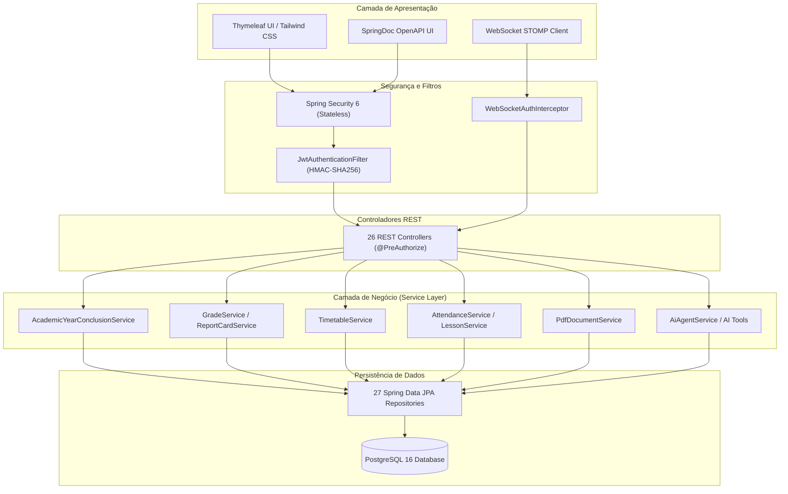
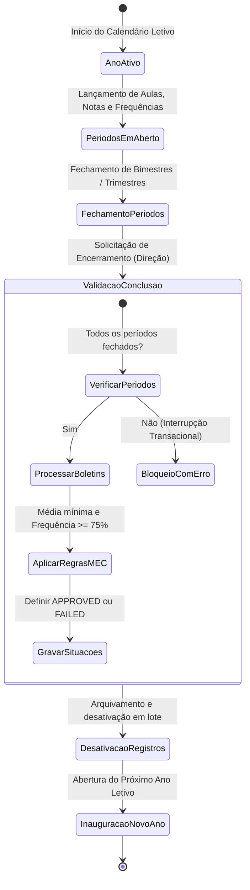
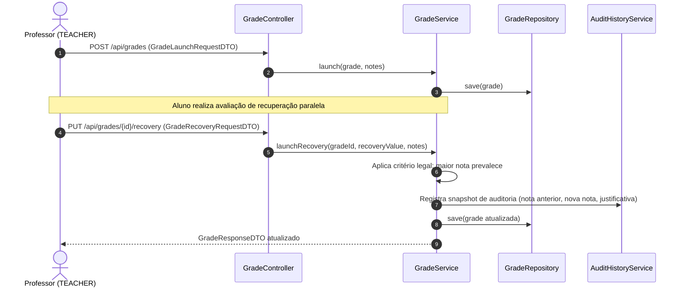

# EscolaWeb — Sistema de Gestão Escolar

<p align="left">
  
  
  
  
  
  
  
  
</p>

---

## Sumário
1. [Visão Geral](#visão-geral)
2. [Abstract (English)](#abstract-english)
3. [Arquitetura de Software](#arquitetura-de-software)
4. [Fluxos Operacionais e Ciclo de Vida](#fluxos-operacionais-e-ciclo-de-vida)
5. [Fundamentação Legal e Regras de Negócio (TCC)](#fundamentação-legal-e-regras-de-negócio-tcc)
6. [Pilha Tecnológica](#pilha-tecnológica)
7. [Instalação e Execução](#instalação-e-execução)
8. [Autenticação e Perfis de Teste](#autenticação-e-perfis-de-teste)
9. [Estrutura do Repositório](#estrutura-do-repositório)

---

## Visão Geral

O **EscolaWeb** é um sistema corporativo de gestão escolar e acadêmica desenvolvido para atender aos requisitos operacionais, pedagógicos e regulatórios da Educação Básica brasileira (Educação Infantil, Ensino Fundamental I e II, e Ensino Médio).

O projeto atua como Trabalho de Conclusão de Curso (TCC) em Engenharia de Software / Ciência da Computação, estruturado sobre os padrões da arquitetura em camadas do ecossistema Spring. Contempla diário de classe digital, consolidação de notas e apuração de médias, controle de absenteísmo conforme a legislação educacional vigente, grade horária semanal com validação de choques de alocação, fechamento e encerramento anual de exercício letivo com máquina de estados finita, emissão de certidões e boletins em PDF com assinatura digital (SHA-256), comunicação em tempo real via WebSocket e um assistente com Inteligência Artificial Generativa sob controle de acesso baseado em papéis (RBAC).

---

## Abstract (English)

**EscolaWeb** is a monolithic web platform engineered for Brazilian K-12 school administration and pedagogical governance. Built on Java 21 LTS and Spring Boot 3.5, it satisfies federal educational standards, including minimum attendance verification (75% threshold pursuant to Brazilian Federal Law 9,394/1996 - LDB), digital gradebooks, weighted and arithmetic average calculations, continuous and parallel recovery mechanisms, weekly schedule clash avoidance, transactional academic year transitions, cryptographic SHA-256 report card generation, real-time messaging, and an AI-driven assistant powered by Spring AI and Google Gemini under strict Role-Based Access Control.

---

## Arquitetura de Software

A aplicação segue a divisão clássica em camadas arquiteturais com inversão de controle, DTOs imutáveis (Records do Java 21) e transacionalidade declarativa (`@Transactional`).



---

## Fluxos Operacionais e Ciclo de Vida

### 1. Transição e Encerramento do Ano Letivo

O encerramento do calendário escolar é governado por uma máquina de estados estrita para prevenir inconsistências em notas, matrículas e turmas:



### 2. Ciclo de Avaliação, Diário e Recuperação Paralela



---

## Fundamentação Legal e Regras de Negócio (TCC)

As decisões de modelagem e validação do sistema foram concebidas com base na legislação educacional brasileira e em princípios consolidados da engenharia de requisitos:

1. **Lei de Diretrizes e Bases da Educação Nacional (LDB - Lei Federal nº 9.394/1996):**
   - **Art. 24, Inciso VI (Assiduidade Mínima Obrigatória):** Exige frequência mínima de 75% do total de horas letivas para aprovação. O sistema automatiza o cômputo na camada de serviço (`ReportCardServiceImpl` e `AcademicYearConclusionServiceImpl`), retendo discentes infrequentes independentemente da pontuação obtida.
   - **Art. 24, Inciso V, Alínea 'e' (Recuperação Paralela Obrigatória):** Estabelece a prevalência dos aspectos qualitativos sobre os quantitativos e a obrigatoriedade de estudos de recuperação ao longo do período letivo. A regra implementada garante que a nota da recuperação paralela substitui a menor avaliação regular anterior sempre que for superior, vedando prejuízo retroativo ao aluno.
2. **Organização Temporal Curricular Flexível (DCN e BNCC):**
   - Suporte simultâneo a regimes **Bimestrais** (4 períodos), **Trimestrais** (3 períodos) e **Semestrais** (2 períodos), permitindo parametrização curricular individual por turma no mesmo exercício letivo.
3. **Resolução de Conflitos na Grade Horária Semanal:**
   - Modelagem de restrições para evitar choques de alocação de docentes em salas ou turmas simultâneas no mesmo horário, tratando a distribuição da carga horária semanal como um problema clássico de restrição de horários (*timetabling*).
4. **Programa Nacional de Alimentação Escolar (PNAE - Lei Federal nº 11.947/2009):**
   - Controle nutricional do cardápio semanal escolar por turno (Matutino, Vespertino e Noturno), possibilitando gestão de merenda e rastreabilidade alimentar.
5. **Segurança e Isolamento de IA com RBAC:**
   - Integração com Google Gemini via Spring AI operando estritamente através de funções delimitadas (`@Tool`), associadas a permissões de acesso baseadas no perfil autenticado (Direção, Secretaria, Professor e Aluno).

---

## Pilha Tecnológica

| Camada / Função | Tecnologia | Versão | Propósito |
|---|---|---|---|
| Runtime | Java OpenJDK | 21 LTS | Linguagem base da aplicação (Virtual Threads, Records, Pattern Matching) |
| Framework Central | Spring Boot | 3.5.x | Injeção de dependências, convenção sobre configuração e ecossistema web |
| Persistência Relacional | Spring Data JPA / Hibernate | 6.x | Mapeamento objeto-relacional, queries customizadas e paginação nativa |
| Banco de Dados | PostgreSQL | 16 | Armazenamento relacional robusto com sequences e integridade referencial |
| Migrações de Esquema | Flyway | Integrado | Versionamento de banco de dados e controle de schemas |
| Segurança | Spring Security | 6.x | Filtros stateless, RBAC (`@PreAuthorize`) e hashing de credenciais BCrypt |
| Tokens de Autenticação | JJWT (Java JWT) | 0.11.5 | Geração e validação de tokens JWT (HMAC-SHA256) e refresh tokens |
| Documentação de API | SpringDoc OpenAPI | 2.8.16 | Mapeamento Swagger UI e especificação OpenAPI 3 |
| Relatórios Oficiais | FlyingSaucer / OpenPDF | 9.1.22 / 2.0.3 | Renderização de HTML/CSS para arquivos binários PDF |
| Comunicação Assíncrona | Spring WebSocket / STOMP | Integrado | Mensageria instantânea e notificações em tempo real |
| Inteligência Artificial | Spring AI | 1.1.9 | Integração com LLM (Google Gemini) e function calling auditado |
| Testes Automatizados | JUnit 5 / Mockito / AssertJ | Integrado | Testes unitários e de integração com cobertura de código |
| Cobertura de Testes | JaCoCo Maven Plugin | 0.8.12 | Verificação e relatórios de cobertura durante o build do CI |
| Contêineres | Docker / Docker Compose | — | Isolamento e execução reprodutível do banco de dados e aplicação |

---

## Instalação e Execução

### Pré-requisitos
- **Java JDK 21** configurado no ambiente (`java -version`)
- **Docker** e **Docker Compose** (para execução conteinerizada do PostgreSQL)
- **Maven** (opcional, wrapper `mvnw` incluído no repositório)

### 1. Clonagem e Configuração do Ambiente
```bash
git clone https://github.com/andretti101/escolaweb.git
cd escolaweb
```

Verifique o arquivo `.env` na raiz do projeto (ou utilize os valores padrão):
```dotenv
DB_NAME=escolaweb
DB_USER=postgres
DB_PASSWORD=postgres
SPRING_DATASOURCE_URL=jdbc:postgresql://localhost:5432/escolaweb
SPRING_DATASOURCE_USERNAME=postgres
SPRING_DATASOURCE_PASSWORD=postgres
JWT_SECRET=404E635266556A586E3272357538782F413F4428472B4B6250645367566B5970
GEMINI_API_KEY=sua_chave_opcional_aqui
```

### 2. Inicialização do Banco de Dados
```bash
docker compose up -d
```

### 3. Compilação e Execução dos Testes
```bash
# Windows
.\mvnw.cmd test-compile
.\mvnw.cmd test

# Linux / macOS
./mvnw test-compile
./mvnw test
```

### 4. Execução da Aplicação
```bash
# Windows
.\mvnw.cmd spring-boot:run

# Linux / macOS
./mvnw spring-boot:run
```

Rotas disponíveis após inicialização:
- **Interface Web:** `http://localhost:8080/`
- **Swagger UI:** `http://localhost:8080/swagger-ui.html`
- **OpenAPI Schema (JSON):** `http://localhost:8080/v3/api-docs`

---

## Autenticação e Perfis de Teste

A carga inicial (`data.sql`) pré-popula a base de dados com usuários representativos para validação das permissões de acesso.

> **Credencial de acesso padrão para todos os perfis:** `senha123`

### 1. Gestão Escolar (Direção e Secretaria)
| Papel | Nome | E-mail de Acesso | Permissões |
|---|---|---|---|
| `PRINCIPAL` | Helena Cristina Vieira | `direcao@example.com` | Acesso total administrativo, encerramento de ano letivo e configurações |
| `SECRETARY` | Ricardo Nogueira Santos | `secretaria@example.com` | Matrículas, enturmações, turmas, disciplinas e cadastros |

### 2. Corpo Docente
| Docente | E-mail de Acesso | Área de Atuação |
|---|---|---|
| Mariana Ribeiro | `mariana.ribeiro@example.com` | Língua Portuguesa |
| Carlos Menezes | `carlos.menezes@example.com` | Matemática |
| Patricia Andrade | `patricia.andrade@example.com` | História |
| Roberto Teixeira | `roberto.teixeira@example.com` | Geografia |
| Fernanda Martins | `fernanda.martins@example.com` | Ciências |
| Juliana Duarte | `juliana.duarte@example.com` | Artes |
| Marcos Rocha | `marcos.rocha@example.com` | Educação Física |
| Luciana Nunes | `luciana.nunes@example.com` | Língua Inglesa |

### 3. Discentes (Alunos de Demonstração)
O banco contém 60 alunos distribuídos entre as turmas ativas (IDs de 11 a 70). Exemplos para consulta de boletim e portal discente:
- `lucas.almeida@example.com`
- `beatriz.lopes@example.com`
- `gabriel.oliveira@example.com`
- `larissa.cardoso@example.com`
- `pedro.gomes@example.com`

---

## Estrutura do Repositório

```text
escolaweb/
├── src/
│   ├── main/
│   │   ├── java/com/andretti101/escolaweb/
│   │   │   ├── config/          # Segurança (JWT, CORS), WebSocket e OpenAPI
│   │   │   ├── controller/      # Endpoints REST e controladores de templates
│   │   │   ├── dto/             # Records DTO de request e response
│   │   │   ├── exception/       # Manipulação global de exceções (RFC 7807)
│   │   │   ├── model/           # Entidades JPA, enums e conversores
│   │   │   ├── repository/      # Interfaces Spring Data JPA e queries JPQL
│   │   │   ├── service/         # Regras de negócio, geração de PDF e ferramentas de IA
│   │   │   └── EscolawebApplication.java
│   │   └── resources/
│   │       ├── application.properties    # Configurações do framework
│   │       ├── data.sql                  # Carga inicial determinística para desenvolvimento
│   │       ├── messages.properties       # Internacionalização (Inglês)
│   │       ├── messages_pt_BR.properties # Internacionalização (Português)
│   │       └── templates/                # Interfaces gráficas com Thymeleaf
│   └── test/                             # 426 testes automatizados (unitários e integração)
├── compose.yaml                          # Configuração de containers Docker
├── Dockerfile                            # Empacotamento de imagem multi-stage
├── pom.xml                               # Gestão de dependências e plugins Maven
└── README.md                             # Documentação técnica do projeto
```
